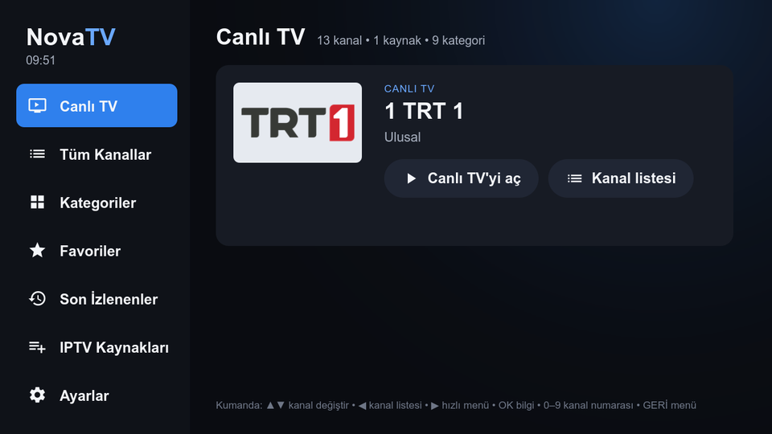
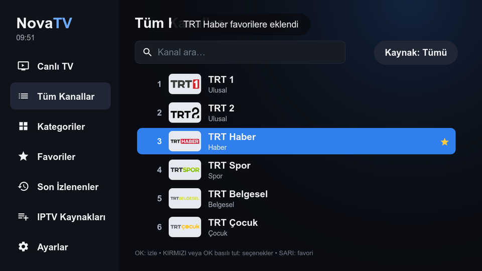
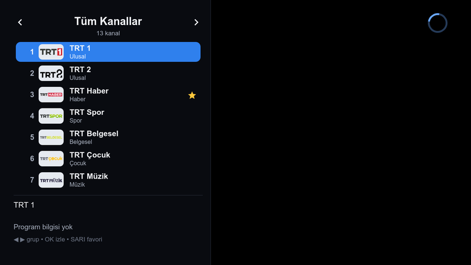
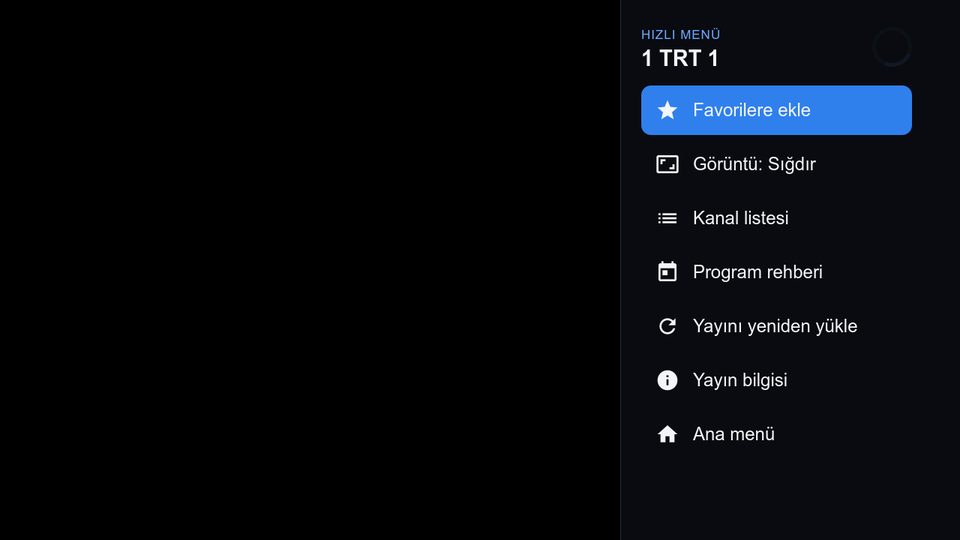
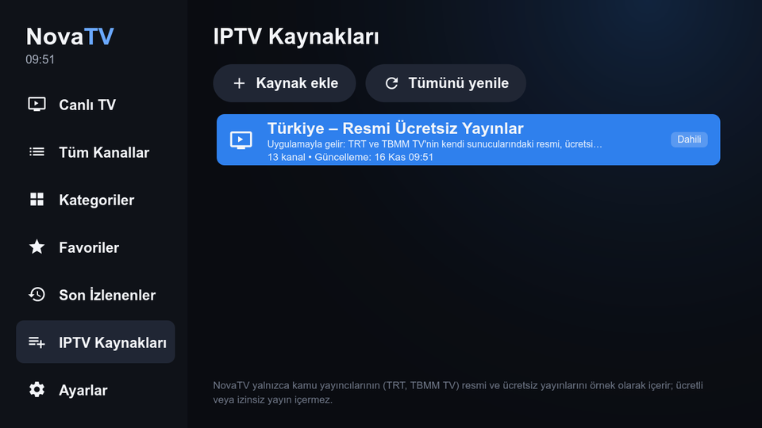
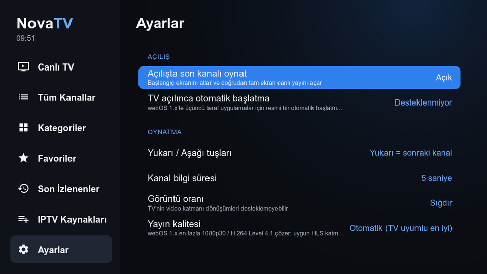

# NovaTV — LG webOS 1.x Sürümü

Android TV için geliştirilen NovaTV IPTV oynatıcısının **LG webOS TV 1.x (2014)** sürümü. Hedef cihaz: **LG 42LB652V-ZA, webOS TV 1.4.0-2536, WebKit 537.41**.

Android uygulamasındaki tasarım, kumanda davranışı, IPTV kaynak yönetimi, M3U ayrıştırma, kanal numaralama/sıralama, favoriler, son izlenenler, son kanal hafızası ve XMLTV EPG mantığı **ES5 JavaScript** ile yeniden yazıldı. Kotlin kodu çalıştırılmıyor; derleme adımı (Babel vb.) yok. Kaynak dosyalar doğrudan eski TV tarayıcısında çalışacak biçimde yazıldı.

| Ana ekran | Tüm Kanallar | Kanal paneli |
|---|---|---|
|  |  |  |
| **Hızlı menü** | **IPTV Kaynakları** | **Ayarlar** |
|  |  |  |

*Ekran görüntüleri PhantomJS 2.1 (WebKit 538.1) ile 1280×720 boyutunda alındı. Bu motorda video oynatılamadığı için oynatıcı arka planı siyah.*

> **Yasal not:** Varsayılan olarak yalnızca kamu yayıncılarının (TRT ve TBMM TV) kendi sunucularından ücretsiz sunduğu resmi yayınlar gelir. Ücretli veya izinsiz yayın içermez. Kendi listelerinizde yalnızca kullanım hakkına sahip olduğunuz bağlantıları kullanın.

> **Önemli:** Uygulama gerçek LG 42LB652V-ZA televizyonunda **henüz denenmedi**. Neyin nerede test edildiğini aşağıdaki "Test durumu" bölümünde ayrıntılı olarak bulabilirsiniz.

---

## 1. Kurulum: bu TV'ye IPK yüklenebilir mi?

LG 42LB652V-ZA (webOS 1.4) için araştırma sonuçları:

| Soru | Bulgu | Durum |
|---|---|---|
| Developer Mode uygulaması bu cihazda çalışıyor mu? | LG'nin CLI kılavuzu: *"From webOS TV 3.0, you can test your app on the actual device using the Developer Mode app."* LG Content Store'daki Developer Mode sayfasının desteklenen modeller listesinde 2014 (webOS 1.0) modellerinin de yer aldığı bildiriliyor, ancak sayfa JavaScript ile oluşturulduğu için içeriği doğrulanamadı. | **Doğrulanmadı.** Resmi belge 3.0+ diyor; bu TV'de mümkün olup olmadığını yalnızca TV'deki LG Content Store gösterebilir. |
| Resmi LG webOS CLI ile bağlantı kurulabiliyor mu? | Yalnızca Developer Mode etkinse mümkün (SSH portu 9922, kullanıcı `prisoner`, anahtar sunucusu ve 6 haneli parola). | Developer Mode'a bağlı. |
| Uygulama IPK olarak paketlenebiliyor mu? | Evet. Resmi `ares-package` (@webos-tools/cli 3.2.6) ile `dist/com.novatv.webos_1.1.0_all.ipk` üretildi. | **Yapıldı ve doğrulandı.** |
| Oluşturulan IPK bu modele yüklenebiliyor mu? | Developer Mode olmadan üçüncü taraf IPK yüklemenin resmi bir yolu yok. | **Doğrulanmadı.** |

Bu yüzden iki desteklenen yol ve bir öneri sunuluyor.

### Yol A: Developer Mode (TV destekliyorsa)

1. TV'de **LG Content Store**'u açıp **"Developer Mode"** uygulamasını arayın.
   - Uygulama listede **yoksa** bu TV'de resmi yöntem kullanılamaz; **Yol B**'ye geçin.
2. Uygulamayı kurup açın ve [LG Developer](https://webostv.developer.lge.com) hesabınızla giriş yapın.
3. **Dev Mode Status**'ı açın; TV yeniden başlar. Uygulamayı tekrar açıp **Key Server**'ı açın.
4. Bilgisayarda (Node.js gerekir):
```bash
npm install -g @webos-tools/cli
```
```bash
ares-setup-device
```
   Açılan sihirbazda **add** seçin. Değerler: ad `tv`, IP adresi TV'nin IP'si, port `9922`, kullanıcı `prisoner`.
```bash
ares-novacom --device tv --getkey
```
   Developer Mode ekranının sol altındaki 6 karakterlik parolayı girin (büyük/küçük harfe duyarlı).
```bash
ares-device --system-info --device tv
```
5. Paketi derleyin, kurun ve başlatın (proje klasöründe):
```bash
npm install
```
```bash
npm run package
```
```bash
ares-install --device tv dist/com.novatv.webos_1.1.0_all.ipk
```
```bash
ares-launch --device tv com.novatv.webos
```

**Developer Mode'un sınırlamaları:**
- Oturum süresi sınırlı. Developer Mode uygulamasından **EXTEND** ile uzatılır.
- Süre dolar ve TV yeniden başlarsa yüklenen uygulamalar silinir.
- TV ağa bağlı olmadan 10 kez yeniden başlatılırsa Developer Mode kapanır.

### Yol B: TV tarayıcısı modu (kurulum gerektirmez, desteklenen alternatif)

Proxy betiği uygulamanın kendisini de sunar. TV'nin yerleşik web tarayıcısı NovaTV'yi bir web sayfası olarak açabilir. LG'ye göre webOS 1.x tarayıcısı Chromium 26 tabanlıdır ve uygulama bu motorla uyumlu ES5 kodu kullanır.

1. Aynı ağdaki bir bilgisayarda, Raspberry Pi'de veya NAS'ta:
```bash
python3 proxy/novatv_proxy.py --port 8787
```
2. TV'de **Web Tarayıcısı**'nı açın ve `http://<bilgisayarın-ip-adresi>:8787/` adresine gidin. Sayfayı yer imlerine ekleyin.
3. NovaTV → Ayarlar → **Proxy adresi** alanına aynı adresi girin (`http://<ip>:8787`).

Bu modun sınırlamaları:
- Tarayıcının adres çubuğu ve menüleri görünebilir.
- Tam ekran video davranışı ve tarayıcının kumanda tuşlarını sayfaya iletip iletmediği bu TV'de denenmedi.
- Bilgisayarın açık olması gerekir.

### Yol C: webOS Homebrew Channel (TV'de Homebrew Channel varsa)

[Homebrew Channel](https://github.com/webosbrew/webos-homebrew-channel), webOS TV'lere topluluk uygulamalarını kuran ve güncelleyen bir uygulamadır. Kendi depo adresinizi ekleyebilirsiniz. NovaTV için bir depo dosyası üretilir. Böylece NovaTV Homebrew Channel'dan kurulur, yeni sürüm çıkınca orada **Update** düğmesi görünür.

1. Homebrew Channel → **Settings → Add repository**
2. Adres: `https://github.com/<kullanıcı>/<depo>/releases/latest/download/apps.json` (sürümler aşağıdaki betikle yayınlandıysa)
3. Listede NovaTV görünür → **Install**

**Önemli:**
- **Bu TV'de denenmedi.** Homebrew Channel'ı kurmak için Developer Mode ya da root gerekir ve ikisi de bu TV için doğrulanmadı.
  - Developer Mode, LG'nin belgesine göre webOS 3.0'dan itibaren var.
  - webosbrew.org'un webOS 1–3 için listelediği root yöntemi (GetMeNow) kendi sayfasına göre 2024 başından sonra çalışmıyor.
- Homebrew Channel'ın arayüzünün webOS 1.x'te "oldukça iyi çalıştığı" README'sinde yazıyor, ancak resmi bir sürüm desteği belirtilmiyor.
- Bu proje root yöntemlerini önermez (aşağıya bakın).

Depo dosyalarını üretip yayınlamak için (GitHub CLI ile):
```bash
tools/release-github.sh kullanici/novatv
```
Betik IPK'yı derler, `apps.json` ile `com.novatv.webos.manifest.json` dosyalarını üretir (IPK'nın SHA-256 özetiyle) ve hepsini GitHub sürümüne ekler.

Homebrew linki her zaman **en son** GitHub sürümünü okur. Bu yüzden yalnızca Android için yeni bir sürüm çıkarıldığında da LG dosyaları `--tag` ile o sürüme eklenmelidir:
```bash
tools/release-github.sh kullanici/novatv --tag v1.1.1
```

**Tarayıcı modu (Yol B) her zaman günceldir:** Uygulama proxy'den açıldığı için proxy klasörü güncellenince TV de güncel sürümü açar.

### Önerilmeyen yollar

webOS 1.x için topluluk tarafından yayımlanmış "root" araçları da var (webosbrew.org'da listelenen yazılım açıkları ve donanım müdahalesi yöntemleri). Bunlar resmi değil ve TV'ye zarar verme riski taşıyor. Bu proje bu yöntemleri kullanmıyor ve önermiyor.

LG Content Store'da yayımlamak ise LG satıcı hesabı ve inceleme süreci gerektiriyor; webOS 1.x için başvuruların hâlâ kabul edilip edilmediği doğrulanmadı.

### Uygulama açılmıyorsa

1.0.1 sürümündeki açılış düzeltmeleri:
- **`appinfo.json` sadeleştirildi.** Yalnızca LG'nin belgelediği alanlar kaldı. 1.0.0'daki `"handlesRelaunch": true` çıkarıldı. Bu ayar açıkken, uygulama arka plandayken simgesine basıldığında onu öne getirme işi uygulamaya kalır (`PalmSystem.activate()`). Açılışta bir hata olursa uygulama hiç öne gelmez ve "açılmıyor" gibi görünür. Artık bunu webOS'un kendisi yapıyor. `requiredACG` ve `transparent` de çıkarıldı (ilki TV alanı değil, ikincisi zaten varsayılan).
- **Açılış koruması eklendi** (`js/core/boot-guard.js`, ilk yüklenen betik).
  - Bir betik yüklenemezse ya da açılışta hata oluşursa boş veya siyah ekran yerine bir hata ekranı çıkar. Ekranda adım, hata mesajı, dosya:satır ve TV'nin tarayıcı motoru bilgisi yazar.
  - OK yeniden dener; başka bir tuş ekranı kapatır.
  - Açılış 10 saniyede tamamlanmazsa yüklenmeyen bileşenler listelenir.
  - Açılış adımları birbirinden ayrıldı; birinin hatası diğerlerini durdurmaz.

Bu düzeltmeler gerçek TV'de denenmedi.

| Belirti | Olası neden | Yapılacak |
|---|---|---|
| `ares-setup-device` ya da `ares-install` "connection refused" veya zaman aşımı veriyor | TV'de Developer Mode yok, kapalı ya da süresi dolmuş | Developer Mode uygulamasını açıp oturumu başlatın veya **EXTEND**'e basın. Uygulama mağazada yoksa bu TV'ye IPK kurulamaz; **Yol B**'yi kullanın |
| `ares-install` hata veriyor | Paket TV tarafından reddedildi | Komut çıktısının tamamını bildirin. Kurulu olup olmadığını `ares-install --device tv --list` ile kontrol edin |
| Simgeye basınca uygulama öne gelmiyor | 1.0.0'daki `handlesRelaunch` | 1.0.1 veya sonraki IPK'yı kurun (aşağıdaki komutlar) |
| Açılış görselinden sonra boş veya siyah ekran kalıyor | Açılışta JavaScript hatası | 1.0.1 bu durumda hata ekranı gösterir; ekranın fotoğrafını gönderin. Developer Mode varsa konsolu `ares-inspect --device tv --app com.novatv.webos --open` ile açın |
| Hata ekranında "Başlatma 10 saniyede tamamlanmadı" yazıyor | Bazı betik dosyaları yüklenmedi | Paketi yeniden kurun; listelenen bileşenleri bildirin |
| Tarayıcı modunda sayfa açılmıyor | TV bilgisayara ulaşamıyor | Önce bilgisayarda `http://127.0.0.1:8787/` adresini açın. TV ile bilgisayar aynı ağda olmalı. Güvenlik duvarında TCP 8787'ye izin verin. TV'ye `https` değil `http://<bilgisayar-ip>:8787/` yazın |

Güncel sürümü kurup başlatmak için:
```bash
ares-install --device tv dist/com.novatv.webos_1.1.0_all.ipk
```
```bash
ares-launch --device tv com.novatv.webos
```

---

## 2. Telefondan / Ağdan ekle (NovaTV Link)

Kumandayla uzun adres yazmamak için **IPTV Kaynakları → Telefondan / Ağdan** ekranını açın. Uygulama yerel ağı tarar ve NovaTV çalıştıran cihazları listeler:

| Bulunan cihaz | Ne yapılır |
|---|---|
| **Android TV'deki NovaTV**: o TV'de *Ayarlar → Telefondan yönet* ekranı açık olmalı (port 8686) | Listeden seçin ve o TV'nin ekranındaki **4 haneli PIN**'i kumandanın rakam tuşlarıyla girin. O TV'deki **URL kaynaklarının hepsi** bu TV'ye kopyalanır; zaten ekli olanlar atlanır. |
| **NovaTV proxy'si** (port 8787) | Proxy adresi otomatik ayarlanır ve sağda bir **QR kod + PIN** belirir. Telefonla QR'ı okutup M3U adresini yapıştırın **veya telefondaki M3U dosyasını seçin**. TV listeyi kendiliğinden ekler. |

Nasıl çalışıyor:
- **Tarama:** Web uygulamaları mDNS kullanamadığı için ağ, kısa `/api/info` istekleriyle taranır.
  - Önce TV'nin kendi alt ağı denenir. Adres webOS bağlantı yöneticisinden alınır; tarayıcı modunda sayfa adresinden çıkarılır.
  - Bulunamazsa en yaygın ev ağları (192.168.1.x, 192.168.0.x) taranır. Bir alt ağın taranması yaklaşık 20 saniye sürer.
  - Ayrıca **IP adresi gir** ile doğrudan bir cihaz denenebilir.
- **Telefondan ekleme için proxy gerekir:** webOS 1.x web uygulaması kendi sunucusunu çalıştıramaz. Telefon kaynağı proxy'ye bırakır, TV iki saniyede bir proxy'yi yoklayıp alır.
- **Telefondan yüklenen dosyalar:** Proxy'de saklanır (`~/.cache/novatv-proxy/uploads`) ve TV'ye `http://<proxy>/files/<rastgele>.m3u` adresiyle eklenir.
- **CORS'a karşı otomatik proxy:** Proxy tanımlıyken bir liste doğrudan indirilemezse (CORS, eski sertifika), uygulama listeyi otomatik olarak proxy üzerinden yeniden dener ve bunu o kaynak için hatırlar.
- **Güvenlik:**
  - Her kaynak gönderimi ve paylaşımı PIN ister; 5 hatalı denemeden sonra 30 saniye kilitlenir.
  - Android TV'deki sunucu yalnızca o ekran açıkken çalışır.
  - Proxy'yi `--token` ile başlattıysanız Ayarlar → Proxy anahtarı'na aynı değeri girin.

---

### Telefondan yönetim (proxy üzerinden)

LG TV'yi de Android TV'deki ile **aynı telefon paneli** ile yönetebilirsiniz.

Panelden yapılabilenler:
- Kaynak ekleme (adres veya telefondaki M3U dosyası), düzenleme, yenileme, açma/kapatma ve silme.
- Tek kanal ekleme ("Kendi kanallarım").
- Kanal gizleme, yeniden adlandırma, numara verme ve favoriler.
- Başka bir NovaTV'den eşitleme.

webOS 1.x uygulaması bağlantı kabul edemediği için **NovaTV proxy'si gerekir**. Telefon komutu proxy'ye bırakır; TV birkaç saniyede bir proxy'yi yoklar, komutu uygular ve sonucu bildirir.

1. Ayarlar → **Proxy adresi** girilmiş olsun.
2. Ayarlar → **Telefondan yönet**: TV'de bir QR kod, kısa adres (`http://<proxy>:8787/manage`) ve PIN görünür. QR'ı okutun; telefon eşleşir ve TV'yi hatırlar.
3. Ayarlar → **Uzaktan yönetim = Açık** ise eşleşmiş telefon, NovaTV açıkken her zaman çalışır. Kapalıysa yalnızca "Telefondan yönet" ekranı açıkken çalışır.

Ayrıntılar:
- PIN yalnızca ekran açıkken ve TV proxy'ye bağlıyken geçerlidir; 5 hatalı PIN'den sonra 30 saniye kilitlenir.
- Eşleşmiş telefonların anahtarları ve TV'nin proxy kimliği proxy'de `~/.cache/novatv-proxy/manage.json` dosyasında saklanır (`--data-dir` ile değiştirilebilir); proxy yeniden başlasa da eşleşme sürer.
- Telefondan gelen M3U dosyası proxy'de saklanır ve TV'ye `/files/…` adresiyle eklenir.
- Telefonda yapılanlar TV'de bildirim olarak görünür. Telefondan gizlenen kanallar Ayarlar → **Gizlenen kanallar** ile geri getirilir.
- Sınırlar: TV kapalıysa veya NovaTV kapalıysa komut uygulanamaz (panel "TV çevrimdışı" der). Uygulama arka planda çalışmaz.

---

## 3. İsteğe bağlı yerel ağ proxy'si

2014 tarihli bir TV'de karşılaşılan sorunlar ve proxy'nin çözümleri:

| Sorun | Proxy çözümü |
|---|---|
| Sunucu file:// kaynaklı web uygulamalarını engelliyor (CORS) | `/fetch` her yanıta `Access-Control-Allow-Origin: *` ekler |
| Yeni sertifika zincirleri (ör. Let's Encrypt; LG'ye göre webOS 5.0'dan itibaren destekleniyor) | Proxy HTTPS'e modern TLS ile bağlanıp TV'ye düz HTTP verir. **Sertifika doğrulaması proxy'de açık kalır, hiçbir yerde kapatılmaz.** |
| `.gz` listeler / XMLTV | Proxy açar |
| 50–150 MB XMLTV dosyaları TV belleğine sığmaz | `/epg` yalnızca listedeki `tvg-id`'leri ve 36 saatlik pencereyi döndürür |
| Yalnızca HTTPS veren HLS yayınları | `/hls` ve `/seg` oynatma listesini ve segmentleri proxy üzerinden aktarır |

Proxy'yi başlatma (Python 3.7+, yalnızca standart kütüphane):
```bash
python3 proxy/novatv_proxy.py --port 8787 --token GIZLI_ANAHTAR
```
TV'de **Ayarlar → Proxy adresi** ve **Proxy anahtarı** alanlarını doldurun. İsteğe bağlı olarak **Tüm istekler proxy üzerinden** seçeneğini açın ya da tek bir kaynak için kaynak düzenleme ekranındaki "proxy üzerinden yükle" seçeneğini kullanın. **Proxy bağlantısını test et** satırı bağlantıyı denetler.

Güvenlik notları:
- Proxy yalnızca http/https adreslerine izin verir.
- `--token` verilirse token olmayan istekleri reddeder.
- İnternete açmayın; yalnızca ev ağında kullanın.

---

## 4. Kumanda

| Tuş (keyCode) | Tam ekran yayında | Listelerde / menülerde |
|---|---|---|
| Yukarı (38) | Sonraki kanal | Yukarı git |
| Aşağı (40) | Önceki kanal | Aşağı git |
| Sol (37) | Kanal listesini aç | Sola git / panelde önceki grup |
| Sağ (39) | Hızlı menüyü aç | Sağa git / panelde sonraki grup |
| OK (13) | Bilgi bandı (hata ekranında: tekrar dene) | Seç; **basılı tut**: seçenekler |
| Geri | Açık katmanı kapat → ana menü | Önceki ekran; ana menüde Canlı TV → uygulamadan çık |
| 0–9 (48–57) | Kanal numarası (son haneden 0,5 sn, değilse 2 sn sonra açılır) | — |
| Kırmızı (403) | Hızlı menü | Kanal seçenekleri (Android'deki MENU) |
| Yeşil (404) | Favoriler listesi | — |
| Sarı (405) | Favorilere ekle / çıkar | Favorilere ekle / çıkar |
| Mavi (406) | Önceki izlenen kanal | — |
| Info (457) | Bilgi bandı | — |
| Oynat/Duraklat (415/19) | Duraklat; devamda canlı noktaya döner | — |
| CH+/CH− (33/34) | Yalnızca firmware bu tuşları iletiyorsa kanal değiştirir | Sayfa atlama |

**Geri tuşu:** `appinfo.json` içinde `"disableBackHistoryAPI": false` kalır (webOS'un varsayılanı). Bir katman açıkken tek bir history kaydı tutulur; Geri bu kaydı geri alır (`popstate`) ve en üstteki katmanı kapatır. Açık katman yoksa history kaydı da yoktur, platform uygulamadan çıkar (webOS 5.0 ve öncesinde Home başlatıcısı açılır). Firmware ham 461 tuş kodunu gönderirse yedek bir zamanlayıcı aynı işi yapar.

**CH+/CH−:** webOS bu tuşları genellikle sistem için ayırır. Uygulama bunlara güvenmez; kanal değiştirme Yukarı/Aşağı ile yapılır.

---

## 5. Android ile özellik karşılaştırması

| Özellik | Android TV | webOS 1.x | Not |
|---|---|---|---|
| Koyu tema, mavi vurgu, kenar menü + 7 bölüm | ✓ | ✓ | Aynı renkler ve oranlar (dp × 1,333 = px, 1280×720) |
| Canlı TV kartı, son izlenenler | ✓ | ✓ | |
| Tüm Kanallar, arama, kaynak filtresi | ✓ | ✓ | Arama Türkçe karakterlere duyarsız; numara eşleşmesi önce gelir |
| Kategoriler, Favoriler, Son İzlenenler | ✓ | ✓ | |
| Kanal taşıma modu, numaraya taşı, favori sıralama | ✓ | ✓ | |
| Çalışmayan kanal işareti, çok kaynak rozeti | ✓ | ✓ | |
| M3U URL, birden fazla kaynak, düzenle/sil/yenile/sırala | ✓ | ✓ | |
| Telefondan ekleme (QR + PIN; adres veya dosya) | ✓ (TV'nin kendi sunucusu) | ✓ (proxy ile) | webOS 1.x uygulaması sunucu çalıştıramaz |
| Ağdaki NovaTV cihazlarını bulup kaynak kopyalama | Paylaşan taraf (port 8686, mDNS) | Alan taraf (ağ taraması) | Android → webOS yönünde |
| Yerel M3U dosyası (USB) | ✓ | ✗ | webOS 1.x web uygulamasında dosya seçici veya USB erişimi yok; dosyayı proxy'li bilgisayardan sunabilirsiniz |
| `.gz` listeler | ✓ | ~ | Proxy ile |
| Kanal başına User-Agent / Referer | ✓ | ✗ | XHR/video bu başlıkları değiştiremez; değerler okunur ama kullanılamaz |
| Resmi Türkiye listesi (13 kanal) | ✓ | ✓ | Logolar pakete gömülü; TRT'nin düz HTTP sunduğu yayınlar `http://` |
| HLS oynatma | ✓ (ExoPlayer) | ✓ (TV'nin yerleşik HLS'i) | MSE/hls.js yok |
| HLS katmanı seçimi | ExoPlayer | ✓ | TV'nin çözebileceği katmanı uygulama seçer: ≤1080p30, H.264 ≤ Level 4.1 |
| MPEG-TS (HTTP) | ✓ | ~ | `video/mp2t` ile denenir; TV'de denenmedi |
| RTSP / UDP | ✓ | ✗ | Tarayıcının video öğesi desteklemez |
| Otomatik yeniden bağlanma + takılma denetimi | ✓ | ✓ | 4 hızlı deneme (1-2-4-8 sn), sonra 15 sn'de bir; 15 sn ilerleme yoksa yeniden bağlanır |
| Anlaşılır hata mesajları (403/404 ayrımı) | ✓ | ✓ | Medya hatasında adres yoklanarak HTTP kodu bulunur (CORS izin verirse) |
| Ses / altyazı parçası seçimi | ✓ | ✗ | WebKit 537'de `audioTracks`/`textTracks` seçimi yok |
| Görüntü oranı (sığdır/doldur/yakınlaştır) | ✓ | ~ | CSS dönüşümüyle; TV'nin donanım video katmanı uygulamayabilir |
| Tampon profili | ✓ | ✗ | Yerel oynatıcı tampon ayarına izin vermiyor; yerine "Yayın kalitesi" ayarı var |
| Bilgi bandı, kanal paneli, hızlı menü, numara girişi | ✓ | ✓ | |
| XMLTV EPG, şimdi/sonra, rehber | ✓ | ✓ | Doğrudan en fazla 12 MB, büyük veya `.gz` dosyalar proxy ile |
| Son kanalı hatırlama, açılışta doğrudan tam ekran | ✓ | ✓ | Liste yüklenmeden son kanal hemen başlar |
| Kaynakları açılışta yenileme | ✓ | ✓ | Sırayla, oynatmayı engellemeden |
| TV açılınca otomatik başlatma | ✓ (BOOT_COMPLETED) | ✗ | webOS 1.x'te resmi API yok; Ayarlar'da açıklanıyor |
| Uyku/uyanma ve arka plan | ✓ | ✓ | `webkitvisibilitychange` ile kod çözücü serbest bırakılır; `webOSRelaunch` ele alınır |

### webOS 1.x'te mümkün olmayanlar
- TV açılışında kendiliğinden başlama (resmi API yok).
- Yerel dosya veya USB'den M3U açma.
- Ses ve altyazı parçası seçimi.
- RTSP ve UDP yayınları.
- Özel User-Agent veya Referer başlıkları.
- Tampon ayarı.
- DRM'li yayınlar (EME yok; DRM korumaları aşılmaz).
- MSE tabanlı oynatıcılar.
- HEVC/AV1 (FHD modellerde) ve 1080p50/60 HLS katmanları.
- Belgelenmiş CH+/CH− tuş desteği.

---

## 6. Test durumu

| Test | Ortam | Sonuç |
|---|---|---|
| ES5 sözdizimi (acorn `ecmaVersion: 5`), yasak API ve CSS taraması, appinfo/HTML başvuruları | Node | ✓ temiz (`npm run check`) |
| Birim testleri: M3U, Türkçe arama anahtarları, XMLTV saat ve tarama, HLS katman seçimi, kanal deposu, ağ yardımcıları, telefondan yönetim (kendi kanalı, gizleme, ad, numara, kalıcılık), eşitleme, panelin iki projede aynı dosya olması | Node | ✓ 14/14 (`npm test`) |
| Uçtan uca arayüz ve kumanda testi (24 kontrol) | **PhantomJS 2.1.1 = QtWebKit 538.1**, ES2015 yok (webOS 1.x/2.x ile aynı kuşak) | ✓ 24/24, 0 JavaScript hatası; IPK içinden çıkarılan dosyalarla da tekrarlandı |
| Gerçek TRT yayını, HLS katman seçimi (TRT 1 → 720p50; 1080p50 Level 4.2 ve 1440p atlandı), proxy üzerinden HTTPS yayın (TRT Türk), proxy ile `.gz` EPG | Chromium 156 (tarayıcı modu) | ✓ |
| Proxy uç noktaları: ping, token, fetch, hls, seg (TRT segmenti), epg, statik dosya, dizin dışı erişim ve file:// engeli | Linux, Python 3 | ✓ |
| Açılış koruması: temiz kopya hata ekranı olmadan açılıyor; init'te hata, eksik betik dosyası ve sözdizimi hatası hata ekranında adım ve dosya:satır ile gösteriliyor; ekran tuşla kapanıyor | PhantomJS 2.1.1, uygulama TV'deki gibi `file://` ile açıldı; IPK'dan çıkarılan dosyalarla tekrarlandı | ✓ 7/7 (`tests/phantom-boot.js`) |
| IPK paketleme ve paket içeriği | `ares-package` 3.2.6 | ✓ `dist/com.novatv.webos_1.1.0_all.ipk` |
| Telefondan / Ağdan ekleme, uçtan uca (6 kontrol) | PhantomJS 2.1.1 + Android TV 7.1.1 emülatörü (port yönlendirmeli) + proxy | ✓ 6/6, 0 JS hatası. Ağ taraması iki cihazı da buldu; proxy otomatik ayarlandı; QR + PIN göründü; "telefondan" gelen liste eklendi; Android TV'deki kaynaklar PIN ile kopyalandı |
| Telefondan yönetim, uçtan uca (13 kontrol) | PhantomJS 2.1.1 ("TV") + proxy (panel API'si sayfanın içinden) | ✓ 13/13, 0 JS hatası. QR + PIN; TV proxy'ye bağlandı; hatalı PIN 403, geçersiz anahtar 401; kanal ekleme, gizleme, telefondan M3U dosyası (+2 kanal), eşitleme için dışa aktarma; ekran kapanınca PIN geçersiz (409), "Uzaktan yönetim" açıkken eşleşme sürüyor (`tests/phantom-manage.js`) |
| Android TV ↔ LG eşitlemesi | Android TV 7.1.1 emülatörü + PhantomJS "LG TV" + proxy | ✓ iki yönde: kendi kanalları, favori, kanal adları, kanal sırası aktarıldı; hiçbir şey silinmedi |
| Homebrew Channel depo dosyası | `tools/homebrew-repo.py` | ✓ üretildi; **Homebrew Channel ile kurulum denenmedi** |
| **LG 42LB652V-ZA üzerinde çalıştırma** | — | **Denenmedi** |

Gerçek TV'de henüz denenmemiş olanlar:
- Developer Mode'un ve IPK kurulumunun bu modelde çalışıp çalışmadığı.
- webOS medya katmanında HLS ve TS oynatma.
- Kumandanın gerçek tuş kodları (renkli tuşlar, Info, CH±) ve uzun OK basışı.
- Ekran klavyesinin davranışı.
- Gerçek bir ev ağında tarama süresi; webOS bağlantı yöneticisinden IP okuma (PalmServiceBridge); telefon kamerasıyla QR okutma.
- `localStorage` kotası.
- TRT'nin HTTPS yayınları için kök sertifika uyumu (DigiCert Global Root G2).
- Görüntü oranı dönüşümleri.
- Tarayıcı modunda tam ekran video.
- TV'nin kendi işlemcisinde akıcılık.

Aşamalı plan durumu:
- **Aşama 1–5:** Gerçek cihaz dışındaki ortamlarda tamamlandı ve doğrulandı.
- **Aşama 6:** Performans tarafında sanal liste, tek spinner animasyonu ve gölgesiz tasarım uygulandı. Gerçek cihaz testi bekliyor.

---

## 7. Geliştirme

```bash
npm install
```
```bash
npm run check
```
```bash
npm test
```
```bash
npm run package
```

- PhantomJS testi (isteğe bağlı): `phantomjs tests/phantom-smoke.js http://127.0.0.1:8787/ [ekran-görüntüsü-klasörü]`. Önce proxy'yi başlatın; proxy uygulamayı da sunar.
- Telefondan yönetim testi: `phantomjs tests/phantom-manage.js http://127.0.0.1:8788/` (proxy `--port 8788 --data-dir <geçici-klasör>` ile çalışırken).
- Açılış koruması testi: `phantomjs tests/phantom-boot.js . <boş-klasör>`. Sunucu gerekmez; uygulamayı `file://` ile açar ve bozuk kopyalarda hata ekranını dener.
- Varsayılan liste Android projesindeki listeden üretilir: `python3 tools/sync-builtin.py ../NovaTV/app/src/main/assets/playlists/turkiye_resmi.m3u > js/data/builtin.js`

### Proje yapısı
```
NovaTV-webOS/
├── appinfo.json            # id, 1280x720, History API ile Geri, ikonlar (yalnızca belgelenmiş alanlar)
├── index.html              # tek sayfa; ES5 betikleri sırayla yüklenir
├── icon.png (80) · largeIcon.png (130) · splash.png (1920x1080)
├── css/app.css             # Android paleti; flexbox/grid/var()/calc() yok
├── js/
│   ├── core/   boot-guard.js (açılış hata ekranı) · base.js (yardımcılar, Türkçe metin anahtarları, olaylar) · storage.js · settings.js · http.js (XHR + proxy)
│   ├── lib/    qrcode.js (qrcode-generator 1.4.4, MIT, ES5)
│   ├── data/   m3u.js (ayrıştırıcı) · builtin.js (resmi liste) · channels.js (kanal deposu, gizli/ad, kendi kanallarım) · epg.js (XMLTV) · link.js (ağ taraması, PIN ile kopyalama, telefon eşleşmesi) · manage.js (panel işlemleri, eşitleme, proxy aktarımı)
│   ├── player/ hls.js (katman seçimi) · player.js (HTML5 video, yeniden bağlanma)
│   ├── input/  keys.js (LG kumanda, katmanlar, History API ile Geri)
│   ├── ui/     widgets.js (sanal liste) · dialogs.js · source-edit.js · link-screen.js · manage-screen.js (Telefondan yönet) · sections.js · settings-section.js · home.js · player-ui.js
│   └── app.js  # açılış, yaşam döngüsü
├── assets/icons/*.svg (Android vektörlerinden) · assets/logos/*.png (resmi kanallar)
├── proxy/novatv_proxy.py   # isteğe bağlı yerel ağ proxy'si + tarayıcı modu sunucusu + NovaTV Link ve yönetim aktarıcısı
├── proxy/phone.html        # "Telefondan ekle" sayfası (Ağdan ekle ekranındaki QR)
├── proxy/manage.html       # telefon yönetim paneli (Android'deki assets/link/manage.html ile aynı dosya)
├── tools/                  # check-es5.js · build-ipk.sh · sync-builtin.py · homebrew-repo.py · release-github.sh
└── tests/                  # run-tests.js (Node) · phantom-smoke.js · phantom-link.js · phantom-boot.js · phantom-manage.js (WebKit 538)
```

### Android → webOS dosya eşlemesi
| Android (Kotlin) | webOS (ES5) |
|---|---|
| `data/M3uParser.kt` | `js/data/m3u.js` |
| `data/ChannelRepository.kt`, `SourceStore`, `UserListsStore` | `js/data/channels.js` + `js/core/storage.js` |
| `epg/XmltvParser.kt`, `EpgRepository.kt`, `EpgCache.kt` | `js/data/epg.js` |
| `player/LivePlayer.kt`, `PlayerErrors.kt` | `js/player/player.js`, `js/player/hls.js` |
| `ui/player/PlayerActivity.kt`, `ChannelPanel`, `QuickMenu`, `InfoBanner` | `js/ui/player-ui.js` |
| `ui/home/MainActivity.kt` + `sections/*` | `js/ui/home.js`, `js/ui/sections.js`, `js/ui/settings-section.js` |
| `ui/sources/SourceEditActivity.kt` | `js/ui/source-edit.js` |
| `ui/common/TvDialog`, `ChannelAdapter`, `LogoLoader`, `TvLayoutManager` | `js/ui/dialogs.js`, `js/ui/widgets.js` |
| `core/Settings.kt`, `HttpClients.kt`, `TextNorm.kt` | `js/core/settings.js`, `js/core/http.js`, `js/core/base.js` |
| `boot/BootReceiver.kt` | Karşılığı yok (bkz. "mümkün olmayanlar") |

## Lisans
MIT — bkz. [LICENSE](LICENSE).
