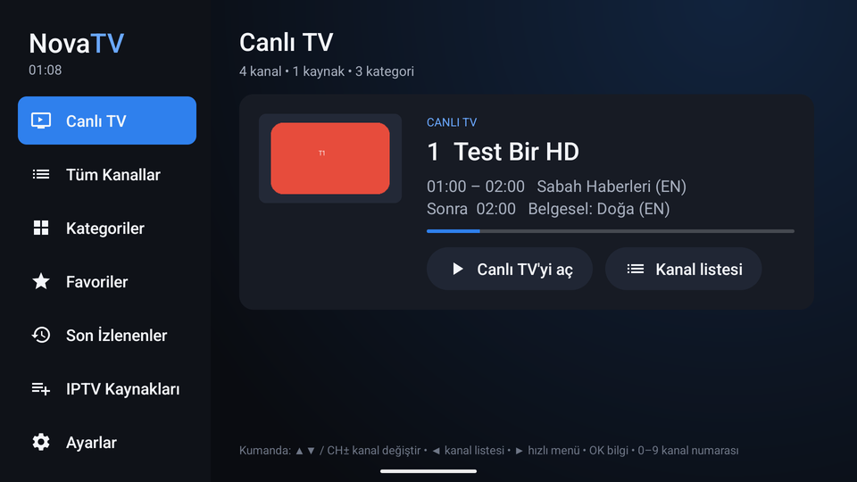
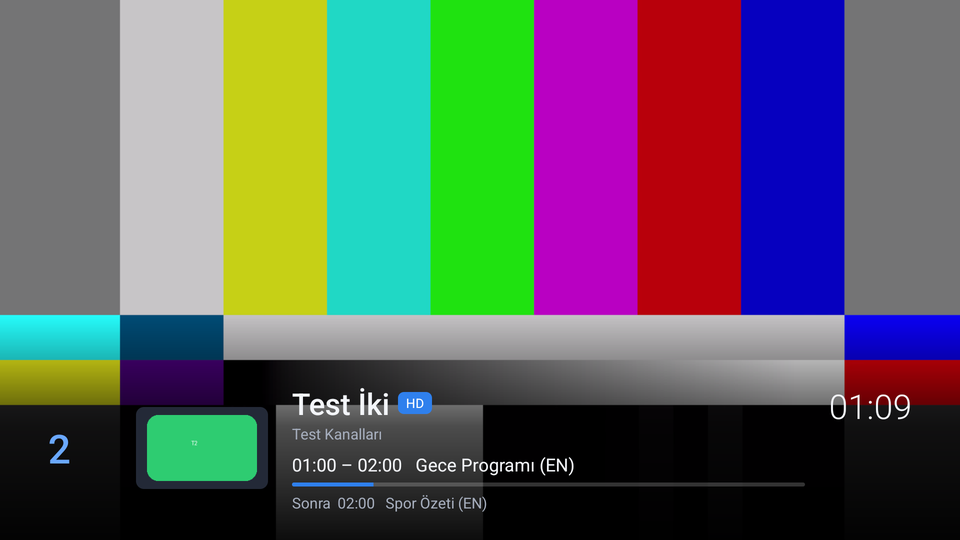
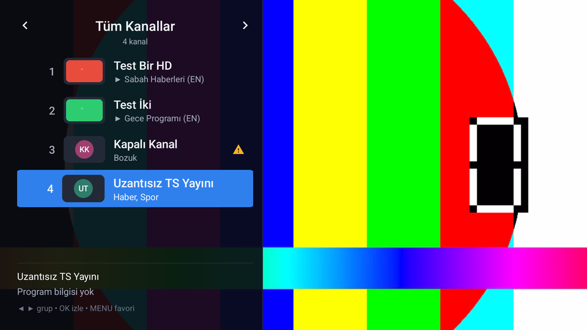
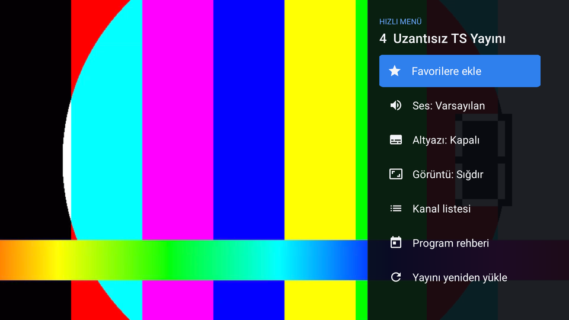
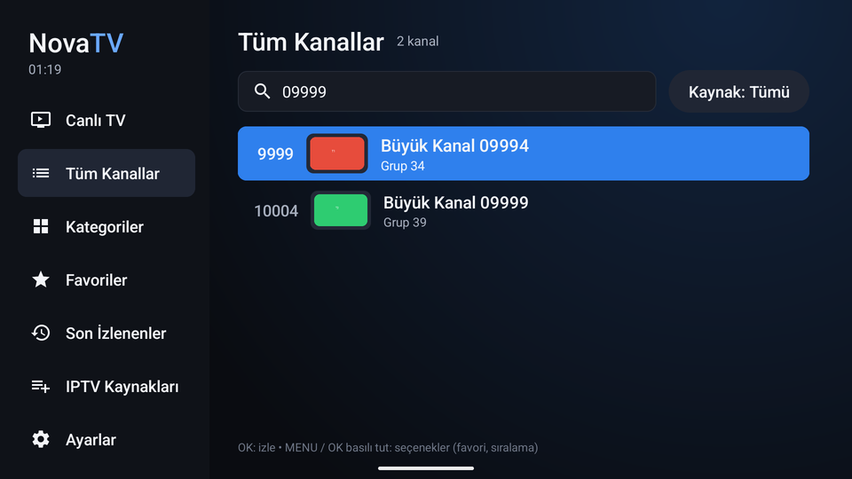
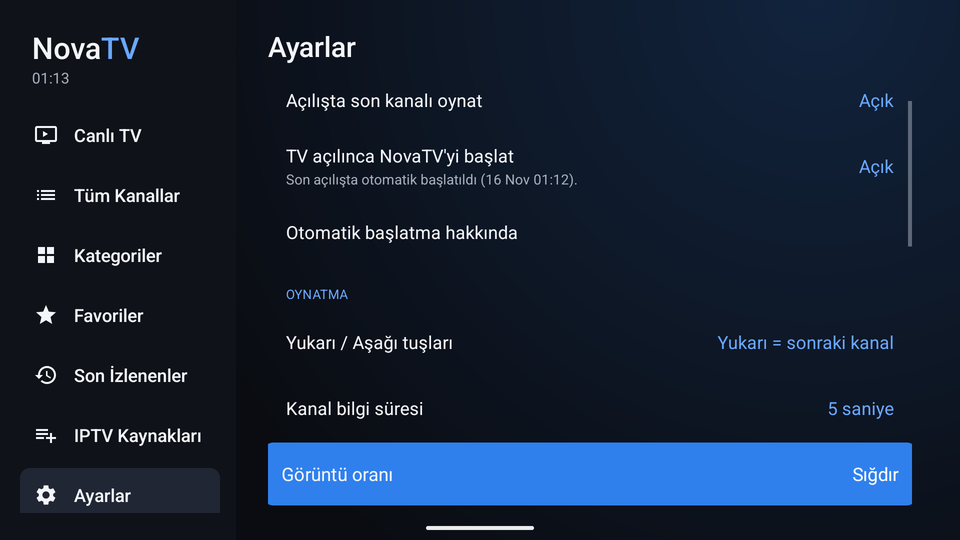

# NovaTV — Android TV IPTV Oynatıcı

NovaTV, normal bir uydu alıcısının internet üzerinden çalışan karşılığı olarak tasarlanmış, açık kaynaklı (MIT) bir Android TV IPTV oynatıcısıdır. TV açıldığında son izlenen kanalı tam ekran oynatır; kanallar televizyonun kendi kumandasıyla (CH+/CH−, yön tuşları, 0–9) değiştirilir. Fare veya dokunmatik ekran gerekmez.

> **Yasal not:** NovaTV, varsayılan olarak yalnızca kamu yayıncılarının (TRT ve TBMM TV) kendi sunucularından herkese ücretsiz sunduğu resmi canlı yayınları içerir; ücretli veya izinsiz yayın içermez. Kendi listelerinizi eklerken yalnızca kullanım hakkına sahip olduğunuz M3U / M3U8 bağlantılarını kullanın.

| Ana ekran | Kanal bandı | Kanal listesi |
|---|---|---|
|  |  |  |
| **Hızlı menü** | **Arama (10.004 kanal)** | **Ayarlar** |
|  |  |  |

*(Ekran görüntüleri, yerel test sunucusunda üretilen test desenleriyle alınmıştır.)*

---

## Varsayılan liste: Türkiye – Resmi Ücretsiz Yayınlar

Uygulama ilk açıldığında, APK'nın içinde gelen [`turkiye_resmi.m3u`](app/src/main/assets/playlists/turkiye_resmi.m3u) listesi otomatik eklenir. Kurulumdan hemen sonra izlenebilecek 13 kanal içerir:

| No | Kanal | Kategori | No | Kanal | Kategori |
|---|---|---|---|---|---|
| 1 | TRT 1 | Ulusal | 8 | TBMM TV | Haber |
| 2 | TRT 2 | Ulusal | 9 | TRT Türk | Uluslararası |
| 3 | TRT Haber | Haber | 10 | TRT Avaz | Uluslararası |
| 4 | TRT Spor | Spor | 11 | TRT World | Uluslararası |
| 5 | TRT Belgesel | Belgesel | 12 | TRT Kurdî | Bölgesel |
| 6 | TRT Çocuk | Çocuk | 13 | TRT EBA TV | Eğitim |
| 7 | TRT Müzik | Müzik | | | |

- Yayınların hepsi yayıncıların kendi sunucularından gelir (`*.medya.trt.com.tr`, `meclistv-live.ercdn.net`); bunu bir birim testi denetler.
- Yalnızca 7/24 yayın yapan kanallar eklendi. TRT 3, yalnızca belirli etkinliklerde yayın yaptığı için bilinçli olarak listede yok.
- Bazı kanallar (ör. TRT 2) yayın hakları nedeniyle yalnızca Türkiye'den izlenebilir.
- Liste her açılışta APK'dan yeniden okunur; uygulama güncellendiğinde yeni yayın adresleri kendiliğinden gelir.
- Listeyi **IPTV Kaynakları** bölümünden devre dışı bırakabilir veya silebilirsiniz. Silinen liste geri gelmez; **Ayarlar → Resmi Türkiye kanallarını ekle** ile yeniden eklenir.
- Bu kanallar için ücretsiz bir XMLTV adresi eklenmedi. EPG istiyorsanız **Ayarlar → Genel EPG adresi**ne kendi XMLTV adresinizi girin; `tvg-id` değerleri yaygın EPG kimlikleriyle (`TRT1.tr` vb.) uyumludur.

---

## Telefondan yönetim (NovaTV Link)

TV'yi telefondan (veya bilgisayar tarayıcısından) yönetebilirsiniz. Kumandayla adres yazmaya gerek kalmaz. Telefon ile TV aynı yerel ağda olmalıdır.

**Eşleştirme (bir kez):** **Ayarlar → Telefondan yönet** (veya IPTV Kaynakları → Telefondan yönet) ekranı açılınca TV'de bir **QR kod**, yerel adres (ör. `http://192.168.1.40:8686`) ve **4 haneli PIN** görünür. QR'ı telefon kamerasıyla okutun; panel açılır ve telefon kendiliğinden eşleşir. QR okutulamıyorsa adresi telefonun tarayıcısına yazıp PIN'i girin. Telefon TV'yi hatırlar; bir daha PIN gerekmez.

**Panelde yapılabilenler:**
- **Kanallar:**
  - Arama, Tümü / Favoriler / Kendi kanallarım / Gizlenenler filtreleri.
  - Favori ekleme ve çıkarma (yıldız).
  - Bir kanala dokununca:
    - Görünen adı değiştirme (boş bırakılırsa listedeki ada döner).
    - Kanal numarası verme.
    - Listeden **gizleme**, gizlenenleri geri getirme.
- **Kaynaklar:** Yenileme, açma/kapatma, ad / adres / EPG adresi düzenleme, silme, kanal sırasını sıfırlama.
- **Ekle:**
  - M3U adresi veya **telefondaki M3U dosyası** (en fazla 8 MB) ile liste ekleme.
  - Adı ve yayın adresiyle **tek kanal ekleme**. Bu kanallar "Kendi kanallarım" listesinde toplanır; panelden düzenlenip silinebilir.
- **Eşitle:**
  - Başka bir NovaTV'den (Android TV ya da proxy üzerinden LG webOS) adres + PIN ile **liste alma**.
  - Bu TV'nin listelerini dosyaya kaydetme ve dosyadan yükleme.

**Eşitleme nasıl çalışır:** Her TV ayrı yönetilir. Eşitlemede diğer TV'nin şunları bu TV'ye **eklenir**; bu TV'deki hiçbir şey silinmez:
- URL kaynakları ve dahili resmi liste
- "Kendi kanallarım"
- Favoriler, gizlenen kanallar ve değiştirilmiş kanal adları

Kanal sırası, yalnızca bu TV'de özel bir sıra yoksa alınır. Telefondan yüklenmiş dosya kaynakları başka cihaza taşınamaz.

**Ne zaman çalışır?**
- "Telefondan yönet" ekranı açıkken her zaman çalışır. PIN yalnızca bu ekran açıkken geçerlidir.
- **Ayarlar → Uzaktan yönetim = Açık** ise eşleşmiş telefonlar, NovaTV çalıştığı sürece (oynatırken dahil) TV'yi yönetebilir. Android uygulamayı kapattığında bağlantı da kapanır; arka plan servisi yoktur.
- Kapalıysa bağlantı yalnızca ekran açıkken çalışır.

**Güvenlik ve sınırlar:**
- Eşleşme PIN ile yapılır; 5 hatalı PIN'den sonra 30 saniye kilitlenir.
- Eşleşmiş telefonlar rastgele bir anahtarla tanınır. **Ayarlar → Eşleşmiş telefonlar** ile tümü silinebilir.
- Bağlantı yerel ağda şifresiz HTTP'dir; NovaTV'yi internete açık bir ağda kullanmayın.
- TV'de yapılanlar ekranda bildirim olarak görünür ("Telefondan: … gizlendi").
- TV'de de bir kanalın menüsünden (MENU / OK basılı) **Kanalı gizle** seçilebilir. Gizlenenler **Ayarlar → Gizlenen kanallar** ile geri gelir.

**LG webOS ile:** LG uygulaması bu TV'nin URL kaynaklarını PIN ile kopyalayabilir; tam eşitleme panelin **Eşitle** sekmesinden yapılır.

**Protokol:**

| Uç nokta | İş |
|---|---|
| `GET /` | Panel (`assets/link/manage.html`; LG proxy'sindeki `proxy/manage.html` ile aynı dosya) |
| `GET /api/info` | Cihaz bilgisi |
| `POST /api/manage/pair` | PIN ile eşleşme, anahtar döner |
| `GET /api/manage/state` | TV'nin kaynak ve kanal durumu |
| `POST /api/manage/cmd` | `source.add/update/delete/refresh/enable`, `channel.add/update/delete/restore/favorite/number`, `order.reset`, `config.export/import` |
| `GET /api/manage/export` | Eşitleme için listeler |
| `GET /api/sources?key=PIN` | LG uygulamasının "PIN ile kopyala" özelliği |

---

## Güncellemeler (GitHub)

NovaTV yeni sürümleri bir **GitHub deposunun Releases** sayfasından alabilir.

**TV'de (bir kez):**
1. **Ayarlar → Güncellemeler → GitHub deposu** varsayılan olarak resmi depodur: [`JustSadY/NovaTV`](https://github.com/JustSadY/NovaTV). Kendi fork'unuzu kullanmak için buraya `kullanıcı/depo` girin (tam GitHub adresi de kabul edilir); boş bırakmak denetimi kapatır. Varsayılan, derlemede `app/build.gradle.kts` içindeki `UPDATE_REPO` değeridir.
2. **Günde bir kez denetle** açıksa NovaTV her gün ilk açılışta son sürümü sorar. Yeni sürüm varsa sürüm notlarıyla birlikte **İndir ve kur** penceresi açılır; istenmeyen sürüm **Bu sürümü atla** ile geçilebilir.
3. **Şimdi denetle** ile elle de bakılabilir.

İndirilen APK kurulmadan önce denetlenir:
- Paket adı NovaTV olmalı.
- Sürüm, yüklü sürümden yeni olmalı.
- Yüklü uygulamayla aynı anahtarla imzalanmış olmalı.

Sonra Android'in kendi kurulum ekranı açılır ve **kurulumu kumandayla siz onaylarsınız**. Sessiz (onaysız) kurulum yoktur; bu ancak Android'in güvenlik kısıtlamaları aşılarak yapılabilirdi. Android 8 ve sonrasında ilk seferde NovaTV'ye "bilinmeyen uygulama yükleme" izni vermeniz istenir; NovaTV ilgili ayar ekranını açar. Android 7'de cihazın "Bilinmeyen kaynaklar" ayarı açık olmalıdır. Listeleriniz ve ayarlarınız güncellemede korunur.

**Sürüm yayınlama (geliştirici):**
1. Bir kez kalıcı bir imza anahtarı oluşturun ve `keystore.properties` dosyasını yazın (yukarıdaki "Derleme" bölümü). Tüm sürümler **aynı anahtarla** imzalanmalıdır; anahtar kaybolursa TV'ler yeni sürümü üstüne kuramaz.
   - Şu ana kadar dağıtılan APK'lar bu bilgisayarın hata ayıklama anahtarıyla imzalı. Kalıcı anahtara geçildiğinde TV'lerde NovaTV **bir kez kaldırılıp** yeniden kurulmalıdır.
   - Geçiş istemiyorsanız betiğe `--allow-debug-key` verin ve `~/.android/debug.keystore` dosyasını yedekleyin.
```bash
keytool -genkeypair -v -keystore novatv-release.jks -alias novatv -keyalg RSA -keysize 2048 -validity 10000
```
2. `app/build.gradle.kts` içinde `versionCode` ve `versionName`'i artırın.
3. GitHub CLI ile oturum açıkken yayınlayın; betik testleri çalıştırır, imzalı APK'yı derler ve sürümü oluşturur:
```bash
tools/release-github.sh kullanici/novatv
```
4. LG için Homebrew linki her zaman **en son** sürümü okur. Bu yüzden LG dosyalarını da aynı sürüme ekleyin (LG uygulaması değişmemiş olsa bile):
```bash
../NovaTV-webOS/tools/release-github.sh kullanici/novatv --tag v1.1.1
```

---

## Özellikler

**Oynatma (Media3 ExoPlayer)**
- HLS (m3u8), MPEG-TS (uzantısız HTTP TS akışları dahil), RTSP ve UDP canlı yayınları
- Uzantısız bağlantılarda otomatik biçim tanıma; TS olarak açılamazsa HLS olarak yeniden dener
- Otomatik yeniden bağlanma: 1-2-4-8 sn aralıklı 4 hızlı deneme, ardından arka planda 15 sn'de bir
- 401/403/404 gibi kalıcı hatalarda bekletmeden anlaşılır Türkçe hata mesajı
- Kanal değiştirirken tek oynatıcı yeniden kullanılır, eski akış düzgün kapatılır
- Hızlı zap: ilk tuş anında kanal değiştirir; tuş basılı tutulursa yalnızca bant güncellenir, bırakınca açılır
- Üç tampon profili (Hızlı geçiş / Dengeli / Kararlı); düşük RAM'li cihazlarda tampon belleği otomatik sınırlanır
- Ses ve altyazı parçası seçimi, görüntü oranı (Sığdır / Doldur / Yakınlaştır)
- Cihazın çözemediği video veya ses biçimleri (ör. AC3/MP2) için uyarı
- Kanal başına `User-Agent` / `Referer` (`#EXTVLCOPT`, Kodi `|User-Agent=` biçimi) ve genel User-Agent ayarı

**Kumanda (uydu alıcısı gibi)** — ayrıntılı tablo aşağıda

**IPTV kaynakları**
- M3U/M3U8 URL ve yerel M3U dosyası (USB bellek / dahili depolama); gzip sıkıştırılmış listeler
- Birden fazla liste; ekleme, düzenleme, silme, etkinleştirme/devre dışı bırakma, sıralama, yenileme
- Açılışta otomatik yenileme (6/12/24/48 saat), "Tümünü yenile"
- Tüm kaynaklar tek kanal listesinde; kaynak bazında filtreleme
- Ayrıştırılan alanlar: kanal adı, `tvg-logo`, `group-title`, `tvg-id`, `tvg-name`, `url-tvg` / `x-tvg-url`, `#EXTGRP`
- Liste aslında tek bir HLS yayınıysa tek kanal olarak eklenir
- Başka bir uygulamadan "Paylaş" veya `VIEW` intent'iyle bağlantı alma

**Kanal yönetimi**
- Global kanal numaraları; uzaktan kumandayla taşıma modu (▲▼ ile yer değiştir, OK ile kaydet) ve "Numaraya taşı"
- Favoriler (sıralanabilir), Son izlenenler (30 kanal), kategoriler
- Ada ve numaraya göre arama (Türkçe karakter ve aksan duyarsız)
- Çalışmayan kanallar ⚠ ile işaretlenir; tekrar açılınca işaret kalkar
- Aynı kanal birden fazla kaynakta varsa kaynak adı rozeti gösterilir
- Kanal kimlikleri yayın URL'sinden bağımsızdır: liste yenilense (token değişse) bile favoriler ve sıralama korunur

**EPG (XMLTV)**
- Genel EPG adresi + kaynak başına EPG adresi + listedeki `url-tvg` otomatik kullanımı
- `tvg-id` ve kanal adıyla (normalleştirilmiş) eşleştirme
- Şu an / sıradaki program, başlangıç–bitiş saatleri, ilerleme çubuğu, program rehberi
- Akış hâlinde ayrıştırma; yalnızca listedeki kanallar ve ~1,5 günlük pencere bellekte tutulur
- İkili (binary) disk önbelleği; 12 saatte bir veya kanal listesi değişince yenilenir
- EPG olmadan uygulama sorunsuz çalışır

**Açılış davranışı**
- Son kanal yerel olarak saklanır; uygulama açılınca liste yüklenmeden bile son kanal hemen oynamaya başlar
- `BOOT_COMPLETED` ile TV açılışında otomatik başlatma (ayarlardan kapatılabilir) ve tanılama ekranı
- TV uykuya geçince oynatıcı ve donanım kod çözücüsü serbest bırakılır, uyanınca kanal yeniden başlar

---

## Kumanda tuşları

| Tuş | Tam ekran yayında | Kanal listesi açıkken |
|---|---|---|
| CH+ / ▲ | Sonraki kanal | 8 kanal yukarı (CH+) / listede yukarı (▲) |
| CH− / ▼ | Önceki kanal | 8 kanal aşağı (CH−) / listede aşağı (▼) |
| ◀ | Kanal listesini aç | Önceki grup (Tümü → Favoriler → kategoriler) |
| ▶ | Hızlı menüyü aç | Sonraki grup |
| OK | Yayın bilgisi bandı (hata ekranında: tekrar dene) | Kanalı aç (açık kanalda OK: listeyi kapat) |
| GERİ | Bilgi bandını kapat → ana menüye dön | Listeyi kapat |
| 0–9 | Doğrudan kanal numarası (2 sn sonra veya son hanede açılır) | Aynı |
| MENU | Hızlı menü | Favorilere ekle / çıkar |
| INFO / GUIDE | Bilgi bandı / kanal listesi | — |
| LAST (önceki kanal) | Bir önceki izlenen kanala dön | — |
| Altyazı / Ses tuşu | Altyazı / ses parçası seçimi | — |
| Oynat/Duraklat | Duraklat; devam ederken canlı noktaya atlar | — |

▲/▼ yönü **Ayarlar → Yukarı / Aşağı tuşları** ile tersine çevrilebilir.

**Kanal tuşları çalışmıyorsa:** Kumandalar CH+/CH− (P+/P−) tuşlarını farklı kodlarla gönderebiliyor. NovaTV bunların hepsini kanal tuşu sayar: `CHANNEL_UP/DOWN`, `PAGE_UP/DOWN` ve ⏭/⏮ (`MEDIA_NEXT/PREVIOUS`).
- Yine çalışmazsa **Ayarlar → CH+ tuşunu öğret / CH− tuşunu öğret** satırını açıp kumandadaki tuşa basın. Android kodu olmayan tuşlar donanım tarama koduyla tanınır.
- Tuşa bastığınız hâlde pencere kapanmıyorsa TV bu tuşu uygulamalara iletmiyor demektir. Bazı TV'ler kanal tuşlarını kendi yayın uygulamasına ayırır. Bu durumda kanal ▲/▼ ile değiştirilir. Ana menüde MENU tuşu veya OK'u basılı tutmak kanal seçeneklerini açar.

---

## Uyumluluk ve sürüm seçimleri

Birincil hedef: **Android TV 7.1.1 (API 25), ARM Cortex-A53, armeabi-v7a / arm64-v8a, düşük RAM.**

| Bileşen | Sürüm | Neden |
|---|---|---|
| minSdk / targetSdk / compileSdk | 21 / 35 / 36 | Android 5.0+ (7.1.1 rahatça kapsanır) |
| Media3 ExoPlayer | **1.8.0** | minSdk 21 olan en yeni Media3 sürümü (1.9+ minSdk 23 ister) |
| Kotlin | 2.2.21 | Kararlı, AGP 8.13 ile uyumlu |
| Android Gradle Plugin | 8.13.2 | AGP 8.x kararlı hattı, JDK 17 |
| Gradle | 8.14.3 (wrapper) | AGP 8.13 için gereken minimum 8.13 |
| OkHttp | 4.12.0 | Media3 OkHttp veri kaynağıyla uyumlu, minSdk 21 |
| Kotlin Coroutines | 1.10.2 | |
| AndroidX core / activity / lifecycle / recyclerview | 1.16.0 / 1.10.1 / 2.9.4 / 1.4.0 | minSdk ≤ 21 olan son sürümler |

- Uygulamada yerel (native) kütüphane yoktur; tek APK hem **armeabi-v7a** hem **arm64-v8a** cihazlarda çalışır.
- Android lint'in `NewApi` denetimi minSdk 21'e göre hatasız geçer (API 23+ çağrılar `ContextCompat` vb. ile karşılanır).
- JSON için Android'in yerleşik `org.json`'u kullanılır; Leanback, Glide, Room gibi ağır kütüphaneler yoktur. Release APK ≈ 1,7 MB.

---

## Derleme (APK oluşturma)

### Gereksinimler
- **JDK 17** (Android Studio'nun gömülü JBR 21'i de çalışır)
- Android SDK Platform 36 ve Build-Tools (Android Studio otomatik kurar)
- İlk derlemede internet (Gradle bağımlılıkları indirilir)

### Android Studio ile
1. AGP 8.13'ü destekleyen güncel bir Android Studio (2025 sürümleri) açın → **Open** → `NovaTV` klasörünü seçin.
2. Gradle eşitlemesi bitince **Build → Build App Bundle(s) / APK(s) → Build APK(s)**.
3. TV'ye doğrudan yüklemek için TV'yi ADB ile bağlayıp ▶ **Run**.

### Komut satırıyla
```bash
cd NovaTV
```
```bash
echo "sdk.dir=$HOME/Android/Sdk" > local.properties
```
```bash
./gradlew assembleRelease
```
Çıktı: `app/build/outputs/apk/release/app-release.apk`
(Hata ayıklama sürümü için `./gradlew assembleDebug` → `app/build/outputs/apk/debug/app-debug.apk`.)

Sisteminizdeki varsayılan Java 17 değilse:
```bash
JAVA_HOME=/usr/lib/jvm/java-17-openjdk ./gradlew assembleRelease
```

Testler ve lint:
```bash
./gradlew testDebugUnitTest lintDebug
```

### İmzalama
Proje kökünde `keystore.properties` yoksa release APK, kurulabilir olması için **debug anahtarıyla** imzalanır. Kendi anahtarınızla imzalamak için:
```bash
keytool -genkeypair -v -keystore novatv.jks -alias novatv -keyalg RSA -keysize 2048 -validity 10000
```
`keystore.properties` (git'e eklenmez):
```properties
storeFile=novatv.jks
storePassword=********
keyAlias=novatv
keyPassword=********
```

---

## TV'ye kurulum

1. TV'de **Ayarlar → Cihaz tercihleri → Hakkında → Yapı numarası**na 7 kez basarak geliştirici seçeneklerini açın, **USB/Ağ hata ayıklama**yı etkinleştirin.
2. Bilgisayardan:
```bash
adb connect TV_IP_ADRESI:5555
```
```bash
adb install -r app/build/outputs/apk/release/app-release.apk
```
Alternatif: APK'yı USB belleğe kopyalayıp TV'de bir dosya yöneticisiyle açın ("Bilinmeyen kaynaklar" izni gerekir).

NovaTV, Android TV ana ekranında banner'ıyla görünür (Leanback launcher).

---

## İlk kullanım

İlk açılışta resmi Türkiye listesi hazır gelir; **Canlı TV**'ye basmanız yeterli. Kendi listenizi eklemenin en kolay yolu **Ayarlar → Telefondan yönet** (yukarıdaki bölüm). Kumandayla eklemek için:

1. **IPTV Kaynakları** → **Kaynak ekle**.
2. **M3U URL** seçip adresinizi girin (veya **Yerel dosya** → USB/dahili depolamadan `.m3u` seçin), isteğe bağlı EPG adresi ve User-Agent ekleyin → **Kaydet ve yükle**.
3. Kanal yüklenince **Canlı TV** ile tam ekrana geçin.

Kumandayla uzun URL yazmak zahmetliyse adresi bilgisayardan gönderebilirsiniz:
```bash
adb shell "am start -n com.novatv.player/.ui.sources.SourceEditActivity --es url 'http://sunucu/liste.m3u' --es name 'Ev IPTV'"
```

---

## TV açılınca otomatik başlatma

- NovaTV, Android'in standart `BOOT_COMPLETED` bildirimini kullanır; ayar açıksa (varsayılan) cihaz açıldığında başlar ve son kanalı oynatır.
- **Çoğu televizyon kumandayla kapatıldığında tamamen kapanmaz, bekleme moduna geçer.** Bu durumda açılış bildirimi gelmez; ancak NovaTV ön plandayken TV uyandığında yayın otomatik devam eder.
- Bazı üreticiler üçüncü taraf uygulamaların açılışta başlamasını engeller; Android 10+ arka plandan uygulama açılmasını kısıtlar. NovaTV bu kısıtlamaları **aşmaya çalışmaz**; **Ayarlar → Otomatik başlatma hakkında** ekranı son açılışta ne olduğunu (sinyal geldi mi, uygulama açıldı mı) gösterir.
- Kurulumdan sonra uygulamayı en az bir kez elle açın (Android, hiç açılmamış uygulamalara açılış bildirimi göndermez).
- TV'nizin ayarlarında "açılışta başlatılacak uygulama / giriş" seçeneği varsa NovaTV'yi seçmek en güvenilir yoldur.

---

## Proje yapısı

```
NovaTV/
├── build.gradle.kts, settings.gradle.kts, gradle.properties
├── gradle/libs.versions.toml            # Tüm bağımlılık sürümleri
├── gradle/wrapper/                      # Gradle 8.14.3 wrapper
├── app/
│   ├── build.gradle.kts, proguard-rules.pro
│   └── src/
│       ├── main/
│       │   ├── AndroidManifest.xml      # Leanback launcher, BOOT_COMPLETED, VIEW/SEND intent'leri
│       │   ├── java/com/novatv/player/
│       │   │   ├── NovaApp.kt, AppGraph.kt          # Uygulama + basit bağımlılık konteyneri
│       │   │   ├── core/        # Settings (SharedPreferences), HttpClients (OkHttp), RemoteKeys (CH tuşları), TextNorm, TimeFmt, AtomicFiles
│       │   │   ├── data/        # Models, M3uParser, PlaylistFetcher, SourceStore, UserListsStore (favori, sıra, gizli/ad), ChannelRepository, CustomPlaylist + ConfigSync
│       │   │   ├── epg/         # XmltvParser (akış), EpgCache (binary), EpgRepository
│       │   │   ├── player/      # LivePlayer (ExoPlayer + yeniden bağlanma), PlayerErrors, TrackHelper
│       │   │   ├── boot/        # BootReceiver
│       │   │   ├── link/        # LinkServer (yerel HTTP), LinkHost (ne zaman çalışır), ManageApi (panel işlemleri, eşitleme), ManageTokens, LinkNetwork (IP, QR, mDNS)
│       │   │   ├── update/      # Updater: GitHub Releases denetimi, indirme, paket/imza doğrulama, Android kurulum ekranı
│       │   │   └── ui/
│       │   │       ├── common/  # ChannelAdapter, LogoLoader, TvDialog, SidebarLayout, TvLayoutManager, …
│       │   │       ├── home/    # MainActivity + sections/ (Canlı TV, Kanallar, Kategoriler, Kaynaklar, Ayarlar)
│       │   │       ├── player/  # PlayerActivity, ChannelPanel, QuickMenu, InfoBanner
│       │   │       └── sources/ # SourceEditActivity, FileBrowserActivity
│       │   ├── assets/playlists/turkiye_resmi.m3u   # Varsayılan resmi TRT / TBMM TV listesi
│       │   ├── assets/link/manage.html               # Telefon yönetim paneli (LG proxy'sindeki ile aynı dosya)
│       │   └── res/             # layout, drawable (vektör ikonlar), values (Türkçe metinler), xml
│       └── test/                # M3U, varsayılan liste, XMLTV, CH tuşları, kendi kanallarım / eşitleme / sürüm birim testleri
├── tools/release-github.sh     # İmzalı APK'yı GitHub Releases'a yayınlar (TV'lerdeki güncelleme denetimi bunu okur)
├── docs/screenshots/
└── dist/                        # Hazır APK kopyaları (git'e eklenmez)
```

**Mimari:** Tek veri kaynağı olan `ChannelRepository` ve `EpgRepository`, değişmez anlık görüntüleri (`StateFlow`) yayınlar; ekranlar bunları yaşam döngüsüne bağlı coroutine'lerle dinler. Ağ, ayrıştırma ve liste oluşturma `Dispatchers.IO`'da çalışır; ana thread'de ağ isteği yoktur. Arka plan servisi kullanılmaz.

---

## Performans notları

- 10.000 kanallık liste test emülatöründe ~0,9 sn'de indirilip ayrıştırıldı; bu listeyle toplam bellek (PSS) ~53 MB, Java heap ~11 MB.
- Listeler `RecyclerView` + kararlı kimliklerle çizilir; yalnızca görünen satırlar bağlanır.
- Logolar küçültülerek (en fazla 220 px) bellek LRU önbelleğinde ve 30 MB OkHttp disk önbelleğinde tutulur; en fazla 4 paralel indirme yapılır, kaydırılan satırların istekleri iptal edilir.
- Oynatıcı yalnızca ekran görünürken yaşar; `onStop`/ekran kapanınca serbest bırakılır.
- EPG yalnızca listedeki kanallar için ve kısa bir zaman penceresinde tutulur.

---

## Doğrulama durumu

- `./gradlew testDebugUnitTest lintDebug assembleDebug assembleRelease` hatasız tamamlanır (21 birim testi, 0 lint hatası).
- Uygulama Android TV (1080p) profilli bir **API 36 x86_64 emülatöründe** uçtan uca denendi: kaynak ekleme, canlı HLS, uzantısız MPEG-TS, 404 veren kanal, numara ile kanal açma, kanal paneli ve grup geçişi, hızlı menü, ses parçası, yayın bilgisi, program rehberi, favoriler, arama, taşıma modu, uyku/uyanma, açılışta son kanal, 10.000 kanallık liste.
- **Android TV 7.1.1 (API 25, `android-tv` x86 resmi sistem imajı, 1,5 GB RAM) emülatöründe** denendi: kurulum ve Leanback başlatıcıda banner, ilk açılışta varsayılan listenin eklenmesi, varsayılan listedeki 13 kanalın tamamının CH+ ile tek tek açılıp görüntü vermesi, numara ile kanal açma, kanal paneli, açılışta son kanalın otomatik oynaması, **cihaz yeniden başlatıldığında NovaTV'nin kendiliğinden açılıp son kanalı oynatması** ve uyku/uyanma. Oynatma sırasında toplam bellek (PSS) ≈ 46 MB.
- **Telefondan / Ağdan ekle**, Android TV 7.1.1 emülatöründe denendi:
  - Telefon sayfasından M3U adresi gönderme (2 kanal eklendi) ve M3U dosyası yükleme (1 kanal)
  - Durum geri bildirimi
  - Yalnızca URL kaynaklarının paylaşılması
  - Hatalı PIN kilidi (5 denemeden sonra 30 saniye)
  - LG webOS uygulamasının bu TV'yi ağda bulup kaynak kopyalaması (PhantomJS'te)
  - Telefon kamerasıyla gerçek QR okutma ve gerçek bir telefonla deneme yapılmadı.
- **1.0.1 kanal tuşları**, Android TV 7.1.1 emülatöründe denendi:
  - `PAGE_UP/DOWN`, `MEDIA_NEXT/PREVIOUS` ve `CHANNEL_UP/DOWN` ile kanal değiştirme
  - Ayarlar'dan yeşil tuşu CH+ olarak öğretme; öğretme penceresinde yön ve ses tuşları yakalanmıyor
  - Öğretilen tuşla oynatıcıda kanal değiştirme
  - Kanal listesinde CH tuşlarıyla 8'er kanal atlama
  - Donanım tarama koduyla eşleştirme yalnızca birim testinde denendi (emülatör tarama kodu göndermiyor). Hi-Level TV'de denenmedi.
- **1.1.0 telefondan yönetim**, Android TV 7.1.1 emülatöründe (port yönlendirmeli) ve uygulama içi Chromium tarayıcısında denendi:
  - Ayarlar'daki yeni satırlar; "Telefondan yönet" ekranında QR + PIN.
  - QR'daki PIN ile panelin kendiliğinden eşleşmesi.
  - Panelden favori, ad değiştirme + numara verme, tek kanal ekleme. "Kendi kanallarım" kaynağı oluştu.
  - Gizleme ve geri getirme; hatalı kaynak ve hatalı kanal adresi için anlaşılır hata.
  - Ekran kapalıyken "Uzaktan yönetim" açık olduğu için eşleşmiş telefonun çalışmaya devam etmesi; yeni eşleşmenin reddedilmesi (409); geçersiz anahtarın reddedilmesi (401).
  - Uygulama 1.0.1'in üzerine kuruldu, eski veriler korundu.
- **Eşitleme** iki yönde denendi:
  - LG (PhantomJS içindeki webOS uygulaması + proxy) → Android TV: kendi kanalı, favori ve kanal adı alındı.
  - Android TV → LG: iki kendi kanalı, ad ve kanal sırası alındı.
- **Güncelleme**, Android TV 7.1.1 emülatöründe gerçek GitHub sürümüyle (v1.1.0) baştan sona denendi:
  - Aynı anahtarla imzalı 1.0.9 test sürümü, açılışta hiçbir ayar yapılmadan varsayılan depodan yeni sürümü buldu.
  - "İndir ve kur" APK'yı indirdi; paket adı, sürüm ve imza doğrulandı.
  - Android kurulum ekranı "mevcut uygulamaya güncelleme" olarak açıldı; onaydan sonra 1.1.0 kuruldu.
  - Var olmayan bir depo için anlaşılır hata mesajı ayrıca denendi.
  - Farklı anahtarla imzalı bir APK'nın reddedilmesi gerçek cihazda denenmedi; yalnızca kodda var.
- Gerçek bir telefonla QR okutma ve gerçek TV'de deneme yapılmadı.
- Testler x86 emülatörlerinde yapıldı; gerçek bir ARM Cortex-A53 televizyonda denenmedi. Uygulamada yerel kod olmadığı için mimari farkı beklenmez, ancak donanım kod çözücü davranışı cihaza göre değişebilir.

## Bilinen sınırlamalar

- DRM'li (Widevine vb.) yayınlar, DASH (`.mpd`) ve RTMP desteklenmez.
- Xtream Codes API ile kullanıcı adı/şifre girişi yoktur; sağlayıcının M3U bağlantısı kullanılmalıdır.
- AC3/E-AC3/MP2 ses, cihazın kendi kod çözücüsüne bağlıdır (FFmpeg eklentisi bilinçli olarak eklenmedi); desteklenmiyorsa uyarı gösterilir.
- Zaman kaydırma / catch-up desteklenmez.
- Varsayılan listedeki yayın adresleri yayıncı tarafından değiştirilebilir; böyle bir durumda uygulama güncellemesiyle veya kendi listenizle devam edilir.
- Sistem dosya seçicisi olmayan TV'lerde dahili dosya tarayıcısı kullanılır; Android 13+ cihazlarda paylaşılan depolamadaki dosyalar için sistem seçicisi gerekebilir.

## Lisans

MIT — bkz. [LICENSE](LICENSE).
